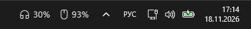

# BatteryBar

A tiny Windows app that shows the battery level of your wireless devices right on the taskbar, next to the notification area.



*Example on Windows 11: wireless headphones at 30% and a mouse at 93%, next to the system tray.*

## Features

- Shows each connected device as an icon plus a percentage (headphones, mouse, keyboard, gamepad, phone).
- Sits on the taskbar to the left of the system tray. You can drag it to another spot, and the position is remembered.
- Built into the taskbar itself (as a child window of `Shell_TrayWnd`), so it stays visible while Start or Search is open and hides together with an auto-hidden taskbar. If Explorer restarts, the widget re-attaches automatically.
- Matches the light or dark taskbar theme. The level turns red at 15% and below.
- Hover to see device names. Right-click for the menu: refresh, hide sleeping devices, start with Windows, reset position, exit.
- **Tray icon** with the same menu, so it's always reachable, even when every device is asleep and the widget is hidden. The icon is a small battery filled to the lowest current level, and hovering it lists every device. On Windows 11, new tray icons go under the "^" overflow at first; drag the icon onto the taskbar to keep it visible.
- **Hides sleeping devices.** When a mouse goes to sleep, it disappears from the taskbar, and it comes back when you move it. This is handy if you have two mice and only use one of them. You can turn it off in the menu (**Скрывать уснувшие устройства**).
- **Automatic updates** from GitHub Releases. The app checks 20 seconds after it starts and then every 6 hours. A new `BatteryBar.exe` is downloaded and checked (file size, the SHA-256 published by GitHub, and the version inside the file), then it replaces the running exe and the app restarts. You can turn this off or check manually from the menu. If the app's folder isn't writable, you only get a notification with a link to the release.
- Hides itself when a full-screen app is running or the taskbar is auto-hidden.
- Updates every 15 seconds, and right away when a device connects or disconnects.
- DPI-aware (per-monitor).

## Supported devices

| Connection | How the level is read |
|---|---|
| **Bluetooth Classic** (headsets with Hands-Free profile) | `DEVPKEY_Bluetooth_Battery` device property, the same source the Windows Settings app uses |
| **Bluetooth LE** (mice, keyboards, gamepads with the GATT Battery Service) | Same as above |
| **Razer 2.4 GHz dongles** (tested with Viper Ultimate) | Razer HID feature report protocol |
| **Logitech** Lightspeed, Unifying and Bolt receivers, or a cable connection | HID++ 2.0: Unified Battery (0x1004), Battery Status (0x1000) or Battery Voltage (0x1001). Voltage readings are converted to an approximate percentage. |
| **Logitech over Bluetooth** (MX Master, MX Anywhere, MX Keys, Lift, POP, …) | HID++ 2.0 over the Bluetooth vendor collection (`FF43:0202`), the same way Solaar and Logi Options+ do it. A device that Windows already reports a battery level for isn't shown twice, and a disconnected device isn't queried. |
| **SteelSeries** Aerox 3/5/9 Wireless, Prime Wireless, Prime Mini Wireless, Rival 3 Wireless (Gen 1 and 2), Rival 650 Wireless | Battery commands from [rivalcfg](https://github.com/flozz/rivalcfg) |
| **Corsair** Slipstream dongles (Harpoon, M65 Ultra, M75, Dark Core RGB Pro, …) | Bragi protocol, based on [ckb-next](https://github.com/ckb-next/ckb-next) and [OpenLinkHub](https://github.com/jurkovic-nikola/OpenLinkHub) |
| **HyperX** Pulsefire Haste 2 Wireless, Haste 2 Core Wireless | NGENUITY "universal" protocol, based on [ngenuity-linux-cli](https://github.com/PMarinov1994/ngenuity-linux-cli) |
| **Glorious** Model O / O- / D / D- Wireless, Model O 2 Wireless, Model D 2 PRO | Sinowealth vendor feature report, based on [glorious-ctl](https://github.com/louis4craft/glorious-ctl). Only known Glorious product IDs are queried, because other brands' devices use the same vendor ID. |
| **Compx platform** (Pulsar X2 V2 / Xlite V3, ATK / VXE, Kysona and other brands built on the same chips) | 17-byte checksummed protocol, based on [python-pulsar-mouse-tool](https://github.com/andrewrabert/python-pulsar-mouse-tool) and the Linux hid-kysona driver. A reply is accepted only with a valid checksum. |
| **SinoWealth 2.4G receiver** `258A:002F` (HATOR Pulsar 2 / Pulsar 2 Pro Wireless, tested; Redragon M910-KS / M690 PRO, Primus Gladius and others) | Read-only feature report commands 0x80 (link) and 0x90 (battery), based on [redragon-m910ks](https://github.com/dominikake/redragon-m910ks) |

### Wireless headsets (USB dongle)

| Brand | Models |
|---|---|
| **SteelSeries** | Arctis 1 / 7 / 7X / 7P / 9, Arctis Pro Wireless, Arctis 7+, Arctis Nova 7 / 7P, Arctis Nova Pro Wireless |
| **HyperX** | Cloud II Wireless, Cloud Alpha Wireless, Cloud Flight |
| **Logitech** | G533, G535, G633 / G635 / G733 / G933 / G935, G PRO / PRO X Wireless |
| **Corsair** | Void / Void Pro / Void Elite family, Void Wireless V2, Virtuoso MAX, HS80 MAX |

Headset protocol details come from [HeadsetControl](https://github.com/Sapd/HeadsetControl).

Razer and HATOR (SinoWealth receiver) support has been tested on real hardware. Support for the other brands and for headsets follows the published protocols, but it hasn't been verified on actual devices. If your device doesn't show up, run `BatteryBar.exe --list` and open an issue with the contents of `devices.txt`.

For Corsair, BatteryBar does not switch the device into "software mode", so lighting and iCUE aren't affected. A device whose firmware only reports the battery level in that mode won't be shown.

Other brands (Zowie, ASUS ROG, Lamzu, …) and some headsets (Logitech G PRO X 2, Razer BlackShark V2 Pro / Barracuda, Audeze Maxwell, HyperX Cloud III Wireless) aren't supported yet.

## Requirements

- Windows 10 (1809+) or Windows 11, x64
- [.NET 8 Desktop Runtime](https://dotnet.microsoft.com/download/dotnet/8.0) (x64)

## Installation

1. Download `BatteryBar.exe` from the [latest release](https://github.com/ivasantai/BatteryBar/releases/latest).
2. Run it. Nothing needs installing, and the app has no window: it only shows up on the taskbar and in the tray.
3. On the first run, BatteryBar turns on **Start with Windows** by itself and shows a notification. You can turn it off from the right-click menu, and it won't be turned back on.

If no supported device is connected, the widget stays hidden.

## Command-line options

| Option | Description |
|---|---|
| `--list` | Writes the detected devices and raw diagnostic data to `devices.txt` next to the exe, then exits |
| `--demo` | Shows sample devices so you can check the look |

## Building from source

Requires the .NET 8 SDK.

```powershell
dotnet publish -c Release -p:PublishSingleFile=true --self-contained false -o publish
```

The output is `publish\BatteryBar.exe`.

Project layout:

| Folder | Contents |
|---|---|
| `Core/` | Settings and the updater |
| `Devices/` | Device polling, Bluetooth, and the shared HID layer |
| `Devices/Vendors/` | One reader per brand or protocol (Razer, Logitech, SteelSeries, Corsair, HyperX, Glorious, Compx, SinoWealth, headsets) |
| `UI/` | Taskbar widget, tray icon, tooltip, and text and glyph rendering |

## Notes

- Settings are stored in `%APPDATA%\BatteryBar\settings.json`. The update log is in `%LOCALAPPDATA%\BatteryBar\update.log`.
- **Start with Windows** adds an entry under `HKCU\Software\Microsoft\Windows\CurrentVersion\Run`.
- When Razer Synapse is running, it talks to the device at the same time, so a query can occasionally fail. In that case the last known level is shown, and the device doesn't flicker on the taskbar. A real "device asleep" answer is told apart from such interference.
- If every device is asleep, the widget hides completely, but the menu stays available from the tray icon.
- Vendor software (G HUB, SteelSeries GG, iCUE, NGENUITY) can stay running. BatteryBar only sends read-only battery queries.

## License

[MIT](LICENSE)
