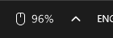

# BatteryBar

A tiny Windows app that shows the battery level of your wireless devices right on the taskbar, next to the notification area.



## Features

- Shows each connected device as an icon plus a percentage (headphones, mouse, keyboard, gamepad, phone).
- Sits on the taskbar to the left of the system tray. You can drag it to another spot, and the position is remembered.
- Matches the light or dark taskbar theme. The level turns red at 15% and below.
- Hover to see device names. Right-click for the menu: refresh, start with Windows, reset position, exit.
- Hides itself when a full-screen app is running or the taskbar is auto-hidden.
- Updates every 30 seconds, and right away when a device connects or disconnects.
- DPI-aware (per-monitor).

## Supported devices

| Connection | How the level is read |
|---|---|
| **Bluetooth Classic** (headsets with Hands-Free profile) | `DEVPKEY_Bluetooth_Battery` device property, the same source the Windows Settings app uses |
| **Bluetooth LE** (mice, keyboards, gamepads with the GATT Battery Service) | Same as above |
| **Razer 2.4 GHz dongles** (tested with Viper Ultimate) | Razer HID feature report protocol |
| **Logitech** Lightspeed, Unifying and Bolt receivers, or a cable connection | HID++ 2.0: Unified Battery (0x1004), Battery Status (0x1000) or Battery Voltage (0x1001). Voltage readings are converted to an approximate percentage. |
| **SteelSeries** Aerox 3/5/9 Wireless, Prime Wireless, Prime Mini Wireless, Rival 3 Wireless (Gen 1 and 2), Rival 650 Wireless | Battery commands from [rivalcfg](https://github.com/flozz/rivalcfg) |
| **Corsair** Slipstream dongles (Harpoon, M65 Ultra, M75, Dark Core RGB Pro, …) | Bragi protocol, based on [ckb-next](https://github.com/ckb-next/ckb-next) and [OpenLinkHub](https://github.com/jurkovic-nikola/OpenLinkHub) |
| **HyperX** Pulsefire Haste 2 Wireless, Haste 2 Core Wireless | NGENUITY "universal" protocol, based on [ngenuity-linux-cli](https://github.com/PMarinov1994/ngenuity-linux-cli) |
| **Glorious** Model O / O- / D / D- Wireless, Model O 2 Wireless, Model D 2 PRO | Sinowealth vendor feature report, based on [glorious-ctl](https://github.com/louis4craft/glorious-ctl). Only known Glorious product IDs are queried, because other brands' devices use the same vendor ID. |
| **Compx platform** (Pulsar X2 V2 / Xlite V3, ATK / VXE, Kysona and other brands built on the same chips) | 17-byte checksummed protocol, based on [python-pulsar-mouse-tool](https://github.com/andrewrabert/python-pulsar-mouse-tool) and the Linux hid-kysona driver. A reply is accepted only with a valid checksum. |

Only Razer support has been tested on real hardware. Support for the other brands follows the published protocols, but it hasn't been verified on actual devices. If your device doesn't show up, run `BatteryBar.exe --list` and open an issue with the contents of `devices.txt`.

**Hator:** we couldn't find any public USB IDs or protocol documentation for Hator mice. If your Hator mouse is built on the Compx platform, it will be picked up automatically. If it doesn't show up, please open an issue with the output of `--list` and your dongle's VID/PID.

For Corsair, BatteryBar does not switch the device into "software mode", so lighting and iCUE aren't affected. A device whose firmware only reports the battery level in that mode won't be shown.

Other brands (Zowie, ASUS ROG, Lamzu, …) each use their own proprietary protocol and aren't supported.

## Requirements

- Windows 10 (1809+) or Windows 11, x64
- [.NET 8 Desktop Runtime](https://dotnet.microsoft.com/download/dotnet/8.0) (x64)

## Installation

1. Download `BatteryBar.exe` from the [latest release](https://github.com/ivasantai/BatteryBar/releases/latest).
2. Run it. Nothing needs installing, and the app has no window: it only shows up on the taskbar.
3. Optional: right-click the widget and enable **Start with Windows**.

If no supported device is connected, the widget stays hidden.

## Command-line options

| Option | Description |
|---|---|
| `--list` | Writes the detected devices and raw diagnostic data to `devices.txt` next to the exe, then exits |
| `--demo` | Shows sample devices so you can check the look |

## Building from source

Requires the .NET 8 SDK.

```powershell
dotnet publish -c Release -p:PublishSingleFile=true --self-contained false -o publish
```

The output is `publish\BatteryBar.exe`.

## Notes

- Settings are stored in `%APPDATA%\BatteryBar\settings.json`.
- **Start with Windows** adds an entry under `HKCU\Software\Microsoft\Windows\CurrentVersion\Run`.
- When Razer Synapse is running, it talks to the device at the same time, so a query can occasionally fail. In that case the last known level is shown for up to 2 hours, which also covers a mouse that has gone to sleep.
- Vendor software (G HUB, SteelSeries GG, iCUE, NGENUITY) can stay running. BatteryBar only sends read-only battery queries.

## License

[MIT](LICENSE)
